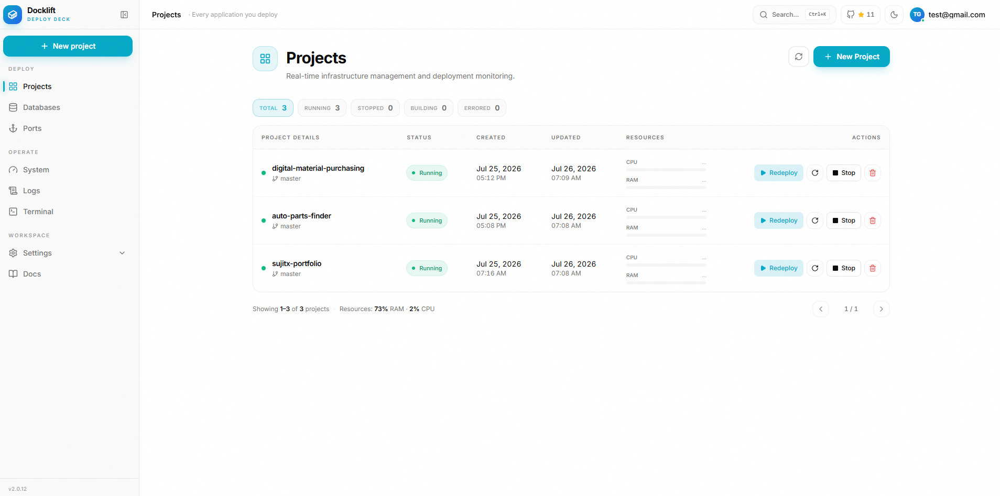
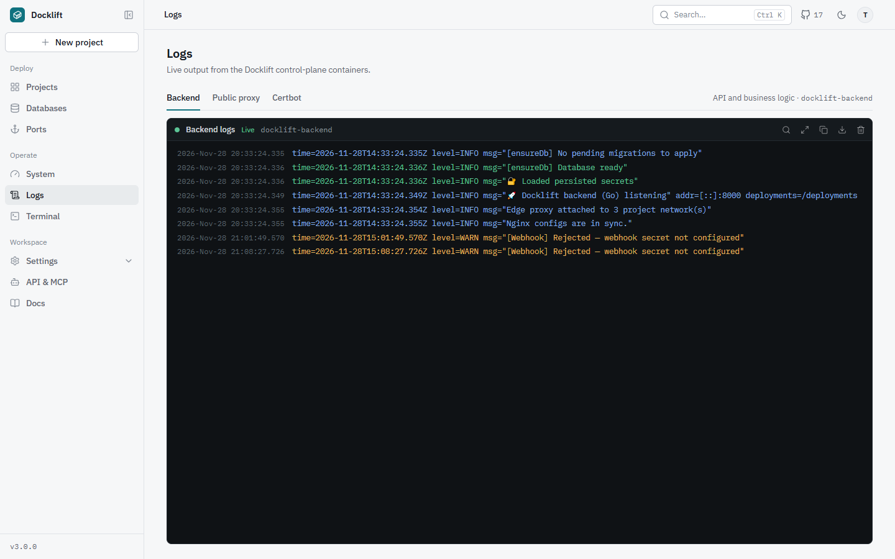
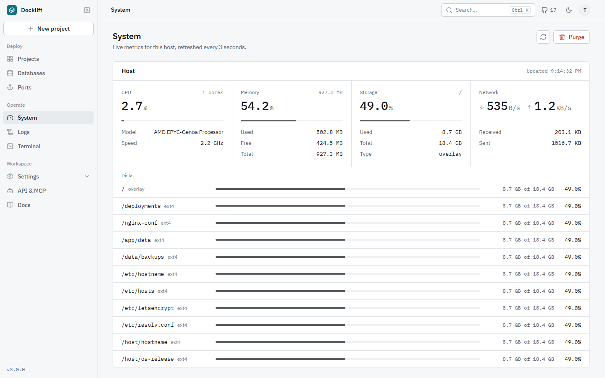

<h1 align="center">Docklift</h1>

<p align="center">
  Self-hosted platform for deploying Docker apps on your own server.<br>
  GitHub or ZIP in, container with a domain and HTTPS out.
</p>

<p align="center">
  <a href="https://github.com/SSujitX/docklift/stargazers"></a>
  <a href="https://github.com/SSujitX/docklift/releases"></a>
  
  
  
</p>

<p align="center">
  <a href="https://docklift.dev">Docs</a> |
  <a href="https://docklift.dev/guide/quick-start">Quick start</a> |
  <a href="commands.md">Commands</a> |
  <a href="CHANGELOG.md">Changelog</a>
</p>

---

## What Docklift is

Docklift turns a Linux server into a deployment platform. You give it a GitHub repository or a ZIP
file. It builds a Docker image (from your `Dockerfile`, or with [Railpack](https://railpack.com/)
when there is none), runs the containers, puts nginx in front of them, gets a Let's Encrypt
certificate for your domain, and redeploys when you push. Everything is driven from a web
dashboard. There is no Kubernetes or Swarm; it uses the Docker Engine on the same host.

Docklift itself is three containers:

| Container | What it does |
|-----------|--------------|
| `docklift-backend` | One Go binary: the API, the WebSocket terminal and the dashboard (embedded). Dashboard on host port `8080`. |
| `docklift-nginx-proxy` | nginx on ports `80` and `443` for your app domains and the optional panel domain. |
| `docklift-certbot` | Requests and renews Let's Encrypt certificates (HTTP-01). |



<details>
<summary>More screenshots</summary>

Project detail:


Live logs of the platform containers:


Host monitoring:


</details>

## Contents

- [Requirements](#requirements)
- [Install](#install)
- [Using Docklift](#using-docklift)
- [Configuration](#configuration)
- [Upgrading from 2.x](#upgrading-from-2x)
- [Tech stack](#tech-stack)
- [Security](#security)
- [Development](#development)
- [Troubleshooting](#troubleshooting)
- [Contributing](#contributing)
- [License](#license)

## Requirements

- A Linux server (amd64 or arm64) with root access and ports `80`, `443` and `8080` reachable.
- Memory: 1 GB RAM is the minimum, 2 GB or more is recommended. The installer and `upgrade.sh`
  build the Docklift image on the server, which needs about 2 GB of RAM + swap at its peak. On a
  smaller host they add a temporary swap file (`/var/tmp/docklift-build.swap`) for the build and
  remove it when they exit; `/etc/fstab` and existing swap are not touched. The build is slower
  then, and building your own apps on a 1 GB server can still run out of memory. Set
  `DOCKLIFT_NO_SWAP=1` to skip the swap file.
- Disk: at least 5 GB free for Docker, the build and its cache (10 GB or more once you deploy
  apps), plus about 2 GB while the temporary swap file exists.
- Docker Engine and git. The installer installs both if they are missing.
- For HTTPS: a domain whose A record points at the server.

Docklift runs as root and mounts `/var/run/docker.sock`; the backend container is privileged with
`pid: host` so it can run system update, reboot and upgrade on the host. Install it on a server you
control, not on a shared host.

## Install

```bash
curl -fsSL https://raw.githubusercontent.com/SSujitX/docklift/master/install.sh | sudo bash
```

The installer clones the latest release into `/opt/docklift`, builds the image, starts the stack
and prints the dashboard URL and a setup code. It shows a progress bar and the running step; if a
step fails it prints the last lines of that step's output and the full log
(`/var/log/docklift-install.log`). To install a specific release, pass the version to
bash (not in the URL):

```bash
curl -fsSL https://raw.githubusercontent.com/SSujitX/docklift/master/install.sh | sudo bash -s -- v=3.0.0
# or
curl -fsSL https://raw.githubusercontent.com/SSujitX/docklift/master/install.sh | sudo DOCKLIFT_VERSION=3.0.0 bash
```

`DOCKLIFT_INSTALL_DIR` changes the install directory. `install-dev.sh` installs unreleased code
from `master`; do not use it for production. Installing an older tag with `install.sh` does not take
the database snapshot that `upgrade.sh` takes, so back up first.

Manual install from a clone:

```bash
git clone https://github.com/SSujitX/docklift.git && cd docklift
docker compose up -d --build
```

## Using Docklift

### First login

The dashboard is at `http://SERVER_IP:8080`. A fresh install has no users, so the first screen is
Setup. Setup needs the bootstrap secret (the "setup code"), which is printed by the installer and
written to the backend log and to `data/.bootstrap-secret`:

```bash
docker logs docklift-backend 2>&1 | grep -A8 "Fresh install"
sudo cat /opt/docklift/data/.bootstrap-secret
```

Enter the code, create the admin account, and the secret is deleted. Anyone who only knows the
server address cannot claim the panel. The first screen can also restore a backup instead of
creating a new account.

Port `8080` is plain HTTP. Put a panel domain on it and turn on **Only allow access through the
domain** (see below), restrict it with a firewall, or set `DASHBOARD_BIND=127.0.0.1` in
`/opt/docklift/.env` and use an SSH tunnel.

### Deploy from GitHub or a ZIP

1. **New Project**, then choose a GitHub repository (public URL, or a private one through the
   GitHub App) or upload a ZIP.
2. Add environment variables if you need them (shared or per service; build-time or runtime).
3. Pick a build mode: **Auto** (your `Dockerfile` if present, else Railpack), **Dockerfile**, or
   **Railpack**. For monorepos set **Base directory**; for a non-root Dockerfile set **Dockerfile path**.
4. **Deploy** and watch the build log. A running build can be cancelled. One deploy runs per project
   at a time.

For private repositories and push-to-deploy, create the GitHub App from **Settings → GitHub**. The
App is yours; Docklift stores its key under `data/`. Pushes to the tracked branch trigger a
redeploy through a webhook; pushes that arrive during a deploy are queued and run once afterwards
with the newest commit.

Apps run on a private Docker network with no host port. Add a domain, or enable **Publish host
ports** on the project to get a port from the pool (`5500`-`5600` by default).

Docklift writes its own compose file to `deployments/.docklift/<project-id>/compose.yml`. It never
reads or modifies a `docker-compose.yml` or `.env` that is in your repository.

### Domains and HTTPS

1. Create an A record pointing at the server.
2. Add the hostname under the project's **Domain** field, or under **Settings → Domain** for the
   dashboard itself.
3. Docklift writes an HTTP vhost, certbot completes the HTTP-01 challenge, and the vhost is
   rewritten with HTTPS and an HTTP to HTTPS redirect. Renewal is checked every 12 hours.

`www.` is not added for you: one hostname without a DNS record fails the whole certificate order.
Create the `www` record first, then add it as a second domain. Behind Cloudflare use SSL mode Full
(strict) and let `/.well-known/acme-challenge/` through on plain HTTP while the certificate is
issued. Issuance errors are shown in the UI; the full log is `docker logs docklift-certbot`.

#### Only allow access through the domain

Once the dashboard has a panel domain with HTTPS, open it at `https://<domain>` and turn on
**Settings → Domain → Only allow access through the domain** (it asks for your password). From then
on `http://SERVER_IP:8080` stops working: browsers are redirected to `https://<domain>`, and API,
terminal and live-log requests on that port get `403`. Only requests that come through
`docklift-nginx-proxy` are served; this is decided from the connection's address (the proxy's fixed
addresses in `TRUSTED_PROXIES`), never from a header a client could send.

- It also applies to `http://127.0.0.1:8080` on the server itself and to SSH tunnels: with Docker's
  port publishing those reach the backend like any other direct client.
- `/api/health` keeps answering `{"status":"ok"}` on `:8080`, so health checks keep working, and
  GitHub webhooks (signed) are still accepted there for GitHub Apps created over the IP address.
- Removing the panel domain, or a certificate retry that ends without HTTPS, turns the switch off
  in the same step; so does a server start that finds no such domain.
- If the domain stops working, reopen the port from the server (no restart needed, applies within
  2 seconds):

  ```bash
  docker exec docklift-backend docklift panel-access open     # allow http://SERVER_IP:8080 again
  docker exec docklift-backend docklift panel-access status   # show the current state
  docker exec docklift-backend docklift panel-access close    # turn it on from the server
  ```

`DASHBOARD_BIND=127.0.0.1` remains the way to close port `8080` on the network entirely.

### Databases

**Databases → New Database** creates PostgreSQL, MySQL, MariaDB, Redis or MongoDB from the official
images, with version tags from Docker Hub. Host ports are off by default. To use one from an app,
**Link** it to the project (or one service): Docklift joins the database to the app's network and
adds the connection URL (`DATABASE_URL`, `REDIS_URL`, `MONGODB_URI`) as a runtime secret. Redeploy
the app afterwards. Credentials are fixed at creation; recreate the database to rotate them.

### Persistent storage

Redeploying replaces containers. Anything the app writes inside the container is lost unless it is
on a volume. Add mounts in the project's **Storage** tab. Volumes are labelled
`com.docklift.project=<id>`, survive redeploys and `docker compose down`, and are removed only when
the project is deleted.

### Backups and restore

**Settings → Backup → Create Backup** writes a zip with the database, project sources, nginx confs,
certificates, the GitHub App key and the secrets. It is stored in `/opt/docklift/backups` and can be
downloaded. Volume contents, including managed database data, are not included; back those up
separately (`pg_dump`, volume snapshots).

**Settings → Restore** replaces the control-plane data from a backup after you confirm with your
password. On a fresh install, choose restore on the setup screen instead of creating an account; the
setup code authorises that one restore. Backups made by 2.1.x restore on 3.x. Projects without a
Docklift-generated compose file are not started and need a redeploy.

### API tokens and AI agents (MCP)

Scripts, CI jobs and AI agents can do what you do in the dashboard with an API token instead of
your password. Create one under **API & MCP** (asks for your password, shows the token once) or on
the server:

```bash
docker exec docklift-backend docklift api-token create ci-deploy           # full access
docker exec docklift-backend docklift api-token create agent --read        # GET requests only
docker exec docklift-backend docklift api-token list
docker exec docklift-backend docklift api-token revoke <id|prefix>
```

Send it as `Authorization: Bearer dl_...`. `GET /api/openapi.json` lists every endpoint. Actions
that ask for the password in the dashboard (rollback, restore, purge, reboot, shell commands) work
with a token only when it was created with **allow dangerous actions**; token management, password
and profile changes, the terminal and the domain-only switch never work with a token.

The same server is an MCP server at `/mcp` (Streamable HTTP, bearer token):

```bash
claude mcp add --transport http docklift https://panel.example.com/mcp --header "Authorization: Bearer dl_..."
```

Every tool call runs through the normal API with the token's permissions. See the
[API guide](https://docklift.dev/guide/api), the [full API reference](https://docklift.dev/guide/api-reference)
(every route, generated from the server's route table) and the [MCP guide](https://docklift.dev/guide/mcp)
(Claude Code, Claude Desktop, Cursor, VS Code and Codex setup, and the tool reference).

### Upgrade

```bash
curl -fsSL https://raw.githubusercontent.com/SSujitX/docklift/master/upgrade.sh | sudo bash
# a specific release:
curl -fsSL https://raw.githubusercontent.com/SSujitX/docklift/master/upgrade.sh | sudo bash -s -- v=3.0.0
```

`upgrade.sh` snapshots the database and nginx confs, builds the new image while nginx-proxy keeps
serving your apps, swaps the backend, waits for `/api/health`, and rolls back automatically if
anything fails after the backend was stopped. The log is `/opt/docklift/upgrade.log`. Data and your
app containers are kept.

### Uninstall

```bash
curl -fsSL https://raw.githubusercontent.com/SSujitX/docklift/master/uninstall.sh | sudo bash -s -- -y
```

This removes every Docklift container, image, volume and network, the build cache, and
`/opt/docklift` (database, deployments, backups, certificates). Other Docker workloads, Docker
Engine and git are left alone.

### Reset the admin password

```bash
docker exec -it docklift-backend docklift reset-password
```

It sets a new random password for the first admin and prints it. Existing sessions stop working.

### Locked out by "Only allow access through the domain"

```bash
docker exec docklift-backend docklift panel-access open
```

`http://SERVER_IP:8080` works again within 2 seconds, without a restart.

More commands (logs, nginx, versions, ports): [commands.md](commands.md).

## Configuration

All variables are optional. Put them in `/opt/docklift/.env` (Compose reads it) and run
`docker compose up -d` in that directory.

| Variable | Default | Purpose |
|----------|---------|---------|
| `DASHBOARD_BIND` | `0.0.0.0` | Host address of the dashboard port `8080`. |
| `PORT_RANGE_START` / `PORT_RANGE_END` | `5500` / `5600` | Host port pool for "Publish host ports". |
| `CERTBOT_EMAIL` | empty | Let's Encrypt account email. |
| `CERTBOT_STAGING` | `false` | Use the staging CA while testing. |
| `CORS_ORIGIN` | empty | Extra allowed browser origins, comma separated. |
| `DOCKLIFT_FRONTEND_URL` | `http://localhost:8080` | Public dashboard URL, used for GitHub App callbacks. |
| `JWT_SECRET` | generated | Generated and kept in `data/.secrets` when empty. |
| `INTERNAL_API_SECRET` | generated | Unused since 3.0; still read and stored so a rollback to 2.1.x works. |
| `TRUSTED_PROXIES` | loopback and nginx-proxy | Peers whose `X-Forwarded-*` headers are believed. See [Security](#security). |
| `DOCKLIFT_BUILD_VERSION` | root `package.json` | Version stamped into the image when building from a clone. |

The backend also reads `DATABASE_URL`, `DATA_PATH`, `DEPLOYMENTS_PATH`, `BACKUP_PATH`,
`NGINX_CONF_PATH`, `LETSENCRYPT_PATH`, `DOCKER_NETWORK`, `CERTBOT_CONTAINER`,
`NGINX_PROXY_CONTAINER`, `TERMINAL_ALLOW_NO_ORIGIN` and `DOCKLIFT_GITHUB_*`; `docker-compose.yml`
sets the container values. The table in [commands.md](commands.md#11-configuration-environment)
lists all of them.

## Upgrading from 2.x

Run the new `upgrade.sh` from GitHub as shown above. The "Upgrade" button on a 2.1.x dashboard runs
the old local script, which cannot switch to the new container layout; it fails safely and rolls
back.

What changes:

- Five containers become three. `upgrade.sh` removes `docklift-frontend` and `docklift-nginx`
  (and the `docklift-frontend` image). The dashboard stays on port `8080`, now served by
  `docklift-backend`.
- Panel-domain nginx confs are rewritten once at boot to proxy to
  `docklift-backend.docklift_network:8000`, and nginx is reloaded, so an existing panel domain keeps
  working.
- The database, `data/.secrets`, deployments, nginx confs, certificates and backups are used as they
  are. 2.1.x backups restore on 3.x.
- Restore starts only Docklift-generated compose files. A project without
  `deployments/.docklift/<id>/compose.yml` (for example from a very old backup) is skipped with "No
  DockLift runtime compose; deploy manually" and must be redeployed.
- `TRUSTED_PROXIES` defaults to loopback plus nginx-proxy's fixed address instead of the whole Docker
  subnet. If your proxy is at another address, set it.
- The `X-Internal-Secret` header is no longer accepted.
- GitHub App setups that were started before the upgrade must be restarted: the setup and manifest
  callbacks now require a `state` that matches the cookie. `http://` GitHub URLs are rejected, and
  `check-installation` no longer falls back to the first installation.
- A service directory whose name equals or starts with `docklift` (case-insensitive) is refused at
  deploy. Rename the directory that holds the Dockerfile.
- Deleting a project removes only the `docklift-<id8>-*` images it built, not upstream images such
  as `postgres`.
- Request bodies are read only after authentication and rate limiting, so an unauthenticated request
  with a bad body gets 401, not 400 or 413. Bodies on `/api/auth/*` are limited to 64 KB.
- Stricter dashboard Content-Security-Policy. The Monaco file editor works again as a side effect.
- If you roll back to 2.1.x, `.secrets` and the database remain readable by it.

## Tech stack

Versions are the ones in `server/go.mod`, `frontend/package.json`, `Dockerfile` and
`docker-compose.yml`.

| Layer | Components |
|-------|------------|
| Backend | Go 1.27 (toolchain 1.27.4), [chi](https://github.com/go-chi/chi) v5.5, SQLite through [modernc.org/sqlite](https://pkg.go.dev/modernc.org/sqlite) v1.63 (pure Go, no cgo, WAL), [golang-jwt](https://github.com/golang-jwt/jwt) v5.3, gorilla/websocket, moby Docker Engine client (`moby/moby/client` v0.6), Docker CLI with compose and buildx plugins, [Railpack](https://railpack.com/) 0.33.0, gopsutil v4.26, creack/pty v1.1, `golang.org/x/crypto` (bcrypt), yaml.v3 |
| Frontend | React 19.3, Vite 8.4 (Rolldown), TypeScript 7.0 (native `tsc`), Tailwind CSS 4.3, Radix UI, React Router 7, Monaco editor, xterm.js 6, lucide, sonner. Built by Bun 1.4.5 and embedded in the Go binary with `go:embed`. |
| Edge | nginx 1.30.8 (reverse proxy), certbot v5.10.0 (Let's Encrypt) |
| Runtime | 3 containers: `docklift-backend` (alpine 3.24 image with the docker CLI, git, bash, Railpack), `docklift-nginx-proxy`, `docklift-certbot` |
| Tooling | GitHub Actions (gofmt, go vet, go test, govulncheck, contract suite, frontend typecheck/build/audit, image build, install and upgrade test, end-to-end suite), semantic-release, VitePress docs |

The Go server lives in `server/` (`cmd/docklift` for the entry point, `internal/` for the packages).
SQL migrations are embedded and applied at start. The database keeps Prisma's `_prisma_migrations`
table as its migration ledger so that 2.x databases and 3.x agree on what is applied.

## Security

The trust model, in short:

- **Docklift is root on the host.** The backend holds the Docker socket and can run commands on the
  host. Anyone with an admin login can run containers, open a root shell (the web terminal) and
  execute host commands. Protect the admin account accordingly. Dangerous actions (terminal, purge,
  reboot, reset, command execution, restore, rollback) ask for the account password again.
- **Step-up throttle.** After 10 wrong passwords for one user from one client address within 15
  minutes, further attempts get 429 with `Retry-After`. A correct password resets the count.
- **First admin.** Creating it needs the bootstrap secret, which is never served over the API. The
  setup token that authorises a restore on a fresh install is deleted when the first admin registers
  and at boot on installs that already have users.
- **Tokens.** Sessions are HS256 JWTs checked against the password version, so changing the password
  invalidates old tokens and closes open log streams and terminals. Terminal tokens are single use
  and the terminal must authenticate within 60 seconds. Log streams use short-lived SSE tokens.
- **API tokens.** `dl_` plus 256 random bits; only the SHA-256 is stored. Read tokens may only send
  GET requests; step-up actions need a token created with "allow dangerous actions"; a token never
  reaches token management, password or profile changes, the terminal or the domain-only switch.
  A password change revokes every token created before it. 20 invalid tokens from one address in
  15 minutes give 429. A full token can deploy containers, and so is close to root on the host
  even without "allow dangerous actions": hand out read tokens where that is enough.
- **`TRUSTED_PROXIES`.** `X-Forwarded-For`, `-Proto` and `-Host` are believed only when the socket
  peer matches this list. The default is `127.0.0.0/8`, `::1/128` and nginx-proxy's fixed addresses
  `172.28.255.254` and `fd12:3456:789a::ffff:fffe`. Other containers on `docklift_network`, which
  includes your deployed apps, cannot forge a client IP. Use `!addr` to exclude an address and `none`
  to trust no peer. If nginx-proxy or another reverse proxy sits at a different address, add it, or
  login rate limits and HTTPS detection will see the proxy instead of the client.
- **Files and secrets.** Data, backup and upload directories are mode 0700 and the files in them
  0600 (database, backups, `.secrets`, GitHub key). The JWT secret, the internal secret and the
  GitHub App variables are not passed to child processes (docker, git, builds, the terminal shell).
  Zip uploads and restores reject paths that escape the target; restored symlinks pointing outside
  the Let's Encrypt area are removed. The file editor blocks `.git` and path traversal.
- **Compose.** Compose commands never run inside the checkout and never read the repository's own
  compose file or `.env`. Deploys of a service named `docklift*` are refused so a project cannot
  shadow Docklift's own containers on the shared network.
- **GitHub.** Webhooks are verified with HMAC over the raw body. The GitHub App is created as
  public because a private App can only be installed on the account that owns it, and the
  "Add Account" flow installs on organisations. Installation binding is protected by the `state`
  check; the listing endpoints still list every installation of the App.
- **Shared build cache.** All projects on one server build with Docker's default BuildKit builder
  and share its cache. Layer cache entries are content-addressed and are reused only when the parent
  layer, command, build args and copied files are identical. BuildKit cache mounts
  (`RUN --mount=type=cache`, used by Railpack for package caches and by many Dockerfiles) are shared
  by id across every build on the host: a repository built here can read and write a cache mount
  that another project's build later uses. Deploy only repositories you trust, or use separate
  Docklift servers for untrusted code. Secret build variables are passed as BuildKit secrets and
  are never written to layers or caches by Docklift. Per-project isolation would need one BuildKit
  builder per project and duplicates the cache per project; Docklift does not do this.
- **Supply chain.** nginx-proxy and certbot images are pinned, the Railpack BuildKit frontend is
  pinned by digest, the Railpack binary is checksum-verified in the Dockerfile, and CI actions are
  pinned by commit SHA.
- **Dashboard.** Plain HTTP on `:8080` is the default for first-run convenience and is not
  encrypted. Use a panel domain with HTTPS and turn on **Only allow access through the domain**
  (requests that did not come through nginx-proxy are redirected or refused; the decision uses the
  socket address, not forwarded headers; `docklift panel-access open` in the container undoes it),
  or close the port with a firewall or `DASHBOARD_BIND=127.0.0.1`.

## Development

Requirements: Go (version in `server/go.mod`), [Bun](https://bun.sh/) 1.4.5, bash and make. Docker
is needed for deploy features and the Docker-gated tests.

```bash
git clone https://github.com/SSujitX/docklift.git && cd docklift
make dev
```

`make dev` runs the Go API on `:8000` and the Vite dev server on `http://127.0.0.1:3600`, which
proxies `/api` and `/ws`. State lives in `./data`, `./deployments`, `./backups` and `./nginx-proxy`
(all gitignored). Without make: `cd server && go run ./cmd/docklift` and, in another terminal,
`cd frontend && bun install --frozen-lockfile && bun run dev`. A `.env` or `.env.local` in the
working directory of the server is loaded.

### Build

| Command | Result |
|---------|--------|
| `make build` | Dashboard plus the Go binary with the dashboard embedded: `bin/docklift` |
| `make server` | Go binary with a placeholder dashboard (enough for API work and tests) |
| `make docker` | `docker build -t docklift-backend .` |
| `docker compose up -d --build` | Build and start the whole stack from the clone |

The version comes from the root `package.json` (bumped by semantic-release). The Dockerfile and
`make build` stamp it into the binary with `-ldflags "-X docklift/internal/version.Version=..."`; a
plain `go build` reports `0.0.0-dev`.

### Tests

| Suite | Command | Needs |
|-------|---------|-------|
| Go unit tests | `cd server && go vet ./... && go test ./...` (or `make test`) | Go. Tests that need Docker skip themselves unless `DOCKLIFT_DOCKER=1`. |
| Contract (HTTP + WebSocket API) | `make contract` | Go. Builds the binary and boots a fresh server per instance. See [tests/contract/README.md](tests/contract/README.md). |
| End-to-end | `cd tests/e2e && DOCKLIFT_E2E_URL=... DOCKLIFT_E2E_ADMIN_PASSWORD=... go test -count=1 -timeout 90m ./...` | A real, throwaway install on a Docker host. Skips without `DOCKLIFT_E2E_URL`. See [tests/e2e/README.md](tests/e2e/README.md). |
| Frontend unit tests | `cd frontend && bun test` | Bun |
| Frontend build | `make frontend` (frozen install, typecheck, `vite build`, `bun audit --prod`) | Bun |
| Lint | `make lint` (gofmt, go vet, `bash -n`, shellcheck, actionlint, `docker compose config`) | shellcheck and actionlint are optional locally |
| Vulnerabilities | `make vuln` (govulncheck) | network |

Run what CI runs with `make lint test contract frontend docker`. `DOCKLIFT_DOCKER=1 make test
contract` also runs the tests that need a Docker daemon.

### What CI runs

- **CI** (`.github/workflows/ci.yml`): gofmt, `go vet`, `go test` and govulncheck; the contract
  suite against the built binary; frontend typecheck, build and `bun audit --prod`; `bash -n` and
  shellcheck on the scripts, the upgrade-script regression test, the check that the scripts' shared
  progress helpers are identical and behave (`scripts/test-ui-helpers.sh`), `docker compose config` and layout
  checks; the image build with a smoke test (health, embedded dashboard, required tools), then the
  Docker-gated Go and contract tests.
- **Install** (`.github/workflows/install.yml`): `install.sh` on a clean runner, first admin,
  checks, `upgrade.sh` over it, and also an install of the latest release upgraded to the current
  commit; then the end-to-end suite.
- **Release** (`.github/workflows/release.yml`) runs semantic-release; **Docs** deploys the
  VitePress site in `website/`.

The frontend unit tests (`bun test`) are not part of the CI job yet.

### Layout

```
server/            Go backend (cmd/docklift, internal/..., web/ for the embedded dashboard)
frontend/          React dashboard (built into server/web/dist by the Dockerfile and make build)
tests/contract/    black-box API suite (own Go module)
tests/e2e/         end-to-end suite against a real install (own Go module)
nginx-proxy/       nginx.conf, snippets and the generated confs of docklift-nginx-proxy
website/           VitePress documentation (docklift.dev)
.agent/skills/     per-subsystem notes for contributors and coding agents
install.sh upgrade.sh uninstall.sh install-dev.sh scripts/
```

### Releases

Versions, `CHANGELOG.md` and GitHub Releases are produced by semantic-release from conventional
commits; do not edit version fields by hand. Every conventional type ships a patch. Put
`*force minor*` or `*force major*` (or a `BREAKING CHANGE`) in the subject for a larger bump, or
`*skip release*` for none. Releases run from GitHub Actions, after CI and Install are green.
See [commands.md](commands.md#6-version-check--release).

## Troubleshooting

| Symptom | Likely cause / fix |
|---------|--------------------|
| Cannot get past Setup | The bootstrap secret is required; see [First login](#first-login). |
| Build fails with "no Dockerfile" | Set the build mode to Railpack, or fix Base directory for a monorepo. |
| `502 Bad Gateway` on a domain | The container is not running, or the app does not listen on the configured internal port. |
| Domain returns nothing or `NXDOMAIN` | DNS record missing or not propagated. |
| Certificate order fails | A hostname in the request has no DNS record; check `docker logs docklift-certbot`. |
| Data disappears after redeploy | Add a mount in the project's Storage tab. |
| "A deployment is already running" | Cancel the running build first; deploys are serialized per project. |
| Deploy refused: service name is reserved | Names starting with `docklift` belong to Docklift; rename the directory with the Dockerfile. |
| Login rate limits hit everyone behind a proxy | Add the proxy to `TRUSTED_PROXIES`. |
| Install or upgrade build "ran out of memory" (exit 137, `Killed`) | Less than ~2 GB RAM + swap and no room for the temporary swap file: free disk space or add swap, then rerun. See [Requirements](#requirements). |

Logs: `docker logs docklift-backend -f`, `docker logs docklift-nginx-proxy -f`,
`docker logs docklift-certbot -f`; app containers are named `dl_<project>_<id>_<service>`
(`docker ps --filter name=dl_`).

## Contributing

1. Fork the repository and create a branch.
2. Make the change with tests. Before opening a pull request run `make lint test contract frontend`.
3. Use conventional commit messages (`feat:`, `fix:`, `docs:`, `refactor:`, `test:`, `chore:`).
4. Open a pull request.

The notes in `.agent/skills/` describe each subsystem and are a good place to start.

## License

MIT, see [LICENSE](LICENSE).
